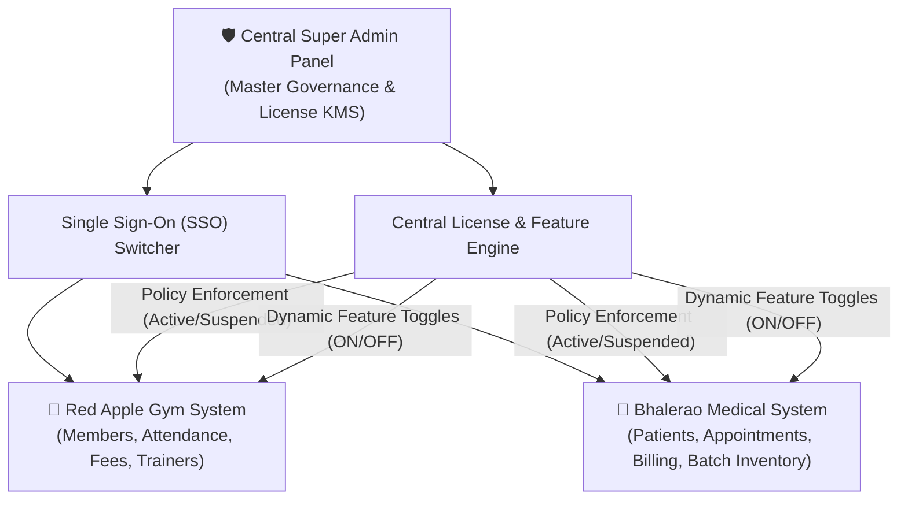

# Centralized SaaS Management Platform
### Master Multi-Tenant Governance: Red Apple Gym + Bhalerao Medical

A complete, production-ready centralized software management platform consisting of **ONE Central Super Admin Panel** and **TWO Independent Business Applications**:

1. **Central Super Admin Panel** (`http://localhost:3000`)
2. **Red Apple Gym Management System** (`http://localhost:3000#gym`)
3. **Bhalerao Medical Management System** (`http://localhost:3000#medical`)

---

## 🏗️ Architecture Overview



---

## 🌟 Key Platform Modules

### 1. Central Super Admin Panel
- **Executive Metrics:** Total apps, registered customers, active/expired/suspended licenses, Standard/Pro/Custom tier counts, MRR & ARR revenue telemetry.
- **Application Access Cards:**
  - **Red Apple Gym:** Direct 1-click SSO launch, member management shortcut, facility revenue, live connection status.
  - **Bhalerao Medical:** Direct 1-click SSO launch, clinical patient records, GST billing shortcut, live connection status.
- **Top Bar Application Switcher:** Seamlessly switch between Super Admin, Red Apple Gym, and Bhalerao Medical without needing separate logins.
- **License Management System:**
  - Issue cryptographically formatted keys (e.g. `RAG-PRO-2026-001`, `BM-STD-2026-002`).
  - Set validity durations, activate, suspend, renew, or extend validity (+30d, +90d, +1y).
- **Dynamic Feature Access Control (Matrix):**
  - Granular toggle for **every individual feature** per customer and per license.
  - Toggling a feature OFF in the Super Admin instantly locks and disables the respective module tab in the client application with a security banner.
- **Customer Management:** Full CRUD to register organizations, assign plans, and link licenses.
- **Audit Logs:** Immutable audit stream tracking every operator action.

---

### 2. Red Apple Gym Management System
- **Dashboard:** Active members, today's attendance count, monthly revenue, pending fees.
- **Member Management:** Registration modal, profiles, phone, blood group, assigned trainers, fee status.
- **Attendance:** Live check-in/check-out with timestamps and biometric/card verification.
- **Trainers & Staff:** Coach profiles, specializations (Bodybuilding, Yoga, HIIT), salary, client rosters.
- **Fees & Payments:** Payment receipt logs, partial payment tracking, pending fee alerts.
- **Workout & Diet Plans:** Hypertrophy PPL, fat loss routines, caloric targets, macro schedules.
- **Expenses & Profit:** Facility rent, equipment maintenance, supplement restocking.
- **Facility Settings:** Operating hours, GSTIN, location config.

---

### 3. Bhalerao Medical Management System
- **Dashboard:** Registered patients, today's appointments, medicine inventory count, low stock warnings (< 20 units), sales revenue.
- **Patient Management:** Clinical registration, demographics, chronic conditions, drug allergies, emergency contacts.
- **Appointments:** Token numbers, consulting doctor schedules, chief complaints.
- **Doctors:** Specialist profiles (Internal Medicine, Cardiology, Pulmonology), consultation fees.
- **Billing & GST:** GST-compliant invoice generation (12% tax calculation), payment modes (UPI, Card, Cash, Insurance).
- **Prescriptions:** Rx generation with diagnoses, medicine dosages, clinical advice.
- **Medicine Inventory & Expiry:** Batch number tracking, shelf/rack codes, MRP, purchase prices, low-stock alerts.
- **Expiry Tracking:** Real-time countdown of medicines expiring in < 30 days or expired.
- **Suppliers:** Wholesale pharmaceutical distributors, Drug License Numbers (`MH-TZ-20B-489201`), GSTIN.

---

## 🚀 Running the Platform

### Option 1: Live Server (Port 3000)
The server is currently running! Open your browser:
- **Central Super Admin:** [http://localhost:3000](http://localhost:3000)
- **Red Apple Gym:** [http://localhost:3000#gym](http://localhost:3000#gym)
- **Bhalerao Medical:** [http://localhost:3000#medical](http://localhost:3000#medical)

To restart or run in another terminal:
```bash
npm start
# or
node server.js
```

### Option 2: MySQL Production Database
A full MySQL 8.0+ DDL script is provided in [`schema.sql`](file:///c:/Users/PRADNYA/OneDrive/Desktop/Control%20Panel/schema.sql) with tables, foreign keys, triggers, and indices.
To import into MySQL:
```bash
mysql -u root -p < schema.sql
```

---

## 🔒 Security & Tenant Isolation
1. **Single Sign-On (SSO):** Master administrator credentials grant unified access across all applications.
2. **Server-Side License Verification:** Every application validates its license key against `/api/license/verify`.
3. **Dynamic Entitlement Shield:** Frontend and backend enforce module authorization based on license permissions.
4. **Data Isolation:** Red Apple Gym records and Bhalerao Medical patient records are stored in logically isolated structures.
